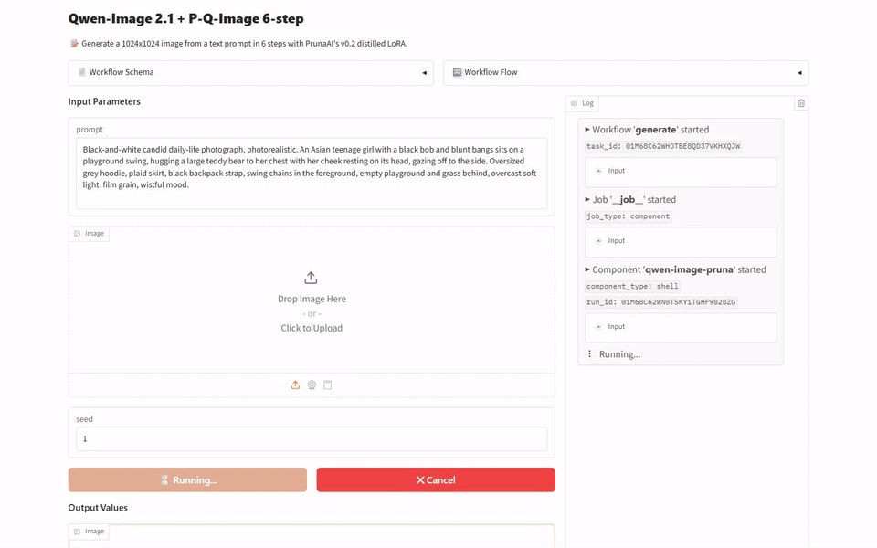
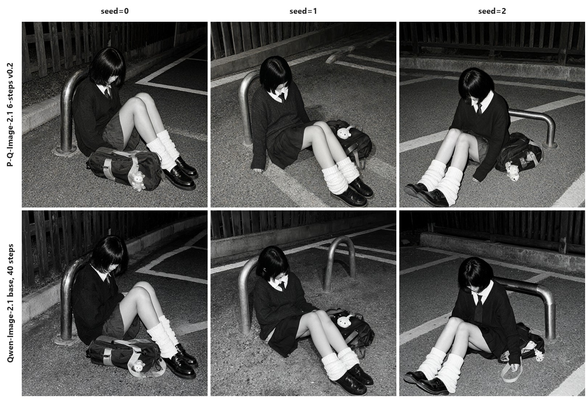
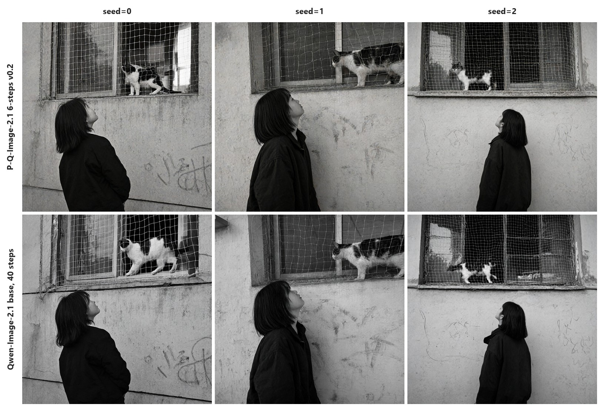
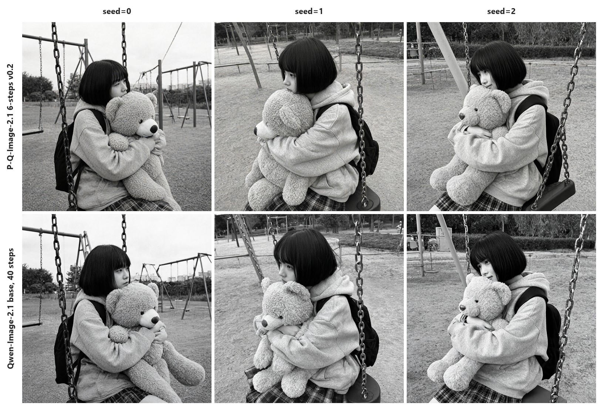

[English](README.md) · [한국어](README.ko.md) · [中文](README.zh.md)

# image-generation-qwen-image-pruna

이 서비스는 글을 받아 Qwen/Qwen-Image-2.1에 P-Q-Image-2.1 6-steps v0.2 LoRA를 얹어 이미지를 만듭니다.



## 빠른 시작

[model-compose](https://github.com/hanyeol/model-compose) 0.4.121 이상이 필요합니다.

[uv](https://docs.astral.sh/uv/)로 설치:

```bash
uv pip install model-compose
```

또는 pip로 설치:

```bash
pip install model-compose
```

이 저장소 클론:

```bash
git clone https://github.com/MindrLabs/image-generation-qwen-image-pruna
cd image-generation-qwen-image-pruna
```

실행:

```bash
model-compose up
```

API 주소는 http://localhost:8080/api 이고, Gradio UI 주소는 http://localhost:8081 입니다.

## 요약

DGX Spark에서 P-Q-Image-2.1 6-steps v0.2는 한 장에 10.9초 걸려 베이스 모델 40단계의 51.3초보다 짧았고, 사람은 화질이 눈에 띄게 떨어지지 않았다고 판정했습니다.

| 기기 | 상태 | 설정 | 장당 초(seed=0) | 최대 메모리(MiB, seed=0) |
| :---: | --- | --- | --- | --- |
| DGX Spark | 측정 | P-Q-Image-2.1 6-steps v0.2 | 10.9 | 39907(VRAM) |
| RTX 4090 | 측정 | P-Q-Image-2.1 6-steps v0.2 | 46.4 | 17532(VRAM) |
| MacBook M1 16GB | 측정 | P-Q-Image-2.1 6-steps v0.2, NF4 512px | 115 | 15581(footprint) |
| RTX 4050 Laptop | 미측정 | — | — | — |

## 측정 환경

| 설정 | 입력 | 가중치 | model-compose | 통계 |
| :---: | --- | --- | --- | --- |
| P-Q-Image-2.1 6-steps v0.2 | 입력 3개 × 반복 1회 | [Qwen/Qwen-Image-2.1](https://huggingface.co/Qwen/Qwen-Image-2.1/tree/d26bb61231c349cf6b7896fa83353113880e1ba3) + [PrunaAI/P-Q-Image-2.1](https://huggingface.co/PrunaAI/P-Q-Image-2.1)의 `p_q_image_2.1_6_steps_v0.2.safetensors` | 0.4.121 | 95% 구간, 1.05배 미만 속도 차이는 판정 제외 |
| 베이스 모델 40단계 | 입력 3개 × 반복 1회 | [Qwen/Qwen-Image-2.1](https://huggingface.co/Qwen/Qwen-Image-2.1/tree/d26bb61231c349cf6b7896fa83353113880e1ba3) | 0.4.121 | 95% 구간, 1.05배 미만 속도 차이는 판정 제외 |
| P-Q-Image-2.1 6-steps v0.2, NF4 512px | 입력 3개 × 반복 3회 | [Qwen/Qwen-Image-2.1](https://huggingface.co/Qwen/Qwen-Image-2.1/tree/d26bb61231c349cf6b7896fa83353113880e1ba3) + [PrunaAI/P-Q-Image-2.1](https://huggingface.co/PrunaAI/P-Q-Image-2.1)의 `p_q_image_2.1_6_steps_v0.2.safetensors` | 0.4.121 | 95% 구간, 1.05배 미만 속도 차이는 판정 제외 |

## 결과

### 텍스트로 이미지 생성

청소년 소녀가 나오는 흑백 일상 사진 세 장면의 구도와 포즈를 영어 프롬프트로 적고 시드 세 개로 만들었습니다.

| 주장 | 확인 방법 | 통과 |
| :---: | --- | --- |
| 자세한 프롬프트로 이미지의 대상, 장소, 빛, 화풍을 조절할 수 있습니다. | 사람 판정 | ✓ |
| 6단계 어댑터는 생성 워크플로에서 베이스 모델 대신 쓰도록 만들어졌습니다. | 사람 판정 | ✓ |
| v0.2 어댑터로 Qwen-Image-2.1이 6단계만에 완성된 이미지를 만듭니다. | 사람 판정 | ✓ |

DGX Spark, RTX 4090, MacBook M1 16GB에서 쟀고, RTX 4050 Laptop은 메모리가 바닥나 재지 못했습니다. 각 칸은 측정한 호출의 중앙값이며 다른 GPU 작업 중에 한 호출은 빼고 계산합니다.

| 설정 | 기기 | 장당 초(seed=0 / 1 / 2) | 최대 메모리(MiB) | 실행 방식 |
| :---: | --- | --- | --- | --- |
| P-Q-Image-2.1 6-steps v0.2 | DGX Spark | 10.9 / 10.9 / 10.9 | 39907(VRAM) |  |
| P-Q-Image-2.1 6-steps v0.2 | RTX 4090 | 46.4 / 46.5 / 46.5 | 17562(VRAM) | 모델 CPU 오프로드 |
| 베이스 모델 40단계 | DGX Spark | 51.3 / 51.2 / 51.3 | 39515(VRAM) |  |
| 베이스 모델 40단계 | RTX 4090 | 62.7 / 62.7 / 62.6 | 17530(VRAM) | 모델 CPU 오프로드 |
| P-Q-Image-2.1 6-steps v0.2, NF4 512px | MacBook M1 16GB | 115 / 116 / 115 | 15581(footprint) | NF4 양자화 |



> Black-and-white candid daily-life photograph, photorealistic, at night under harsh flash. An Asian teenage girl in a school uniform — dark knit sweater, white collar, tie, pleated skirt, white slouch socks — sits slumped on the gravel ground, leaning back against a curved metal parking bollard, knees bent, head bowed so her black bob and bangs hide her face, utterly exhausted. Her school bag lies spilled open beside her with a small plush charm. Wooden fence and concrete curb behind, painted parking lines on the asphalt, flash-lit grainy snapshot, lonely late-night mood.



> Black-and-white candid daily-life photograph, photorealistic. An Asian teenage girl with a shoulder-length bob, seen from behind at a three-quarter angle in a dark jacket, standing below a ground-floor window and tilting her face up toward a black-and-white cat walking along the window ledge behind a white safety net. Rough plaster wall with faded graffiti, dusk light, soft film grain, quiet melancholic mood.



> Black-and-white candid daily-life photograph, photorealistic. An Asian teenage girl with a black bob and blunt bangs sits on a playground swing, hugging a large teddy bear to her chest with her cheek resting on its head, gazing off to the side. Oversized grey hoodie, plaid skirt, black backpack strap, swing chains in the foreground, empty playground and grass behind, overcast soft light, film grain, wistful mood.

## 추천

- 빨리 만들어야 하면 P-Q-Image-2.1 6-steps v0.2를 쓰세요. DGX Spark에서 한 장에 10.9초 걸려 베이스 모델의 51.3초보다 짧았습니다.

## 한계와 측정하지 않은 것

### 측정 조건

| 대상 | 내용 |
| :---: | --- |
| MacBook M1 16GB | NF4 워크플로는 16 GB 통합 메모리를 가진 Apple M1에서 돌았고, 거기서는 파이프라인 전체가 한 메모리에 머뭅니다. |
| VRAM이 따로 있는 GPU | NF4 파이프라인이 먼저 GPU에 올라가고, 그다음 모델 CPU 오프로드가 쉬는 모듈을 시스템 메모리에 두기 때문에 둘 다 넉넉해야 합니다. |
| NF4 로딩 | 양자화하기 전에 BF16 가중치를 읽어서, 잠깐 동안 양자화된 파이프라인보다 많은 시스템 메모리가 필요합니다. 그래서 6 GB GPU와 15 GB 시스템 메모리를 가진 노트북은 전체 메모리가 M1과 비슷한데도 메모리가 바닥납니다. |
| NF4 비교 | NF4 워크플로는 애드온을 뺀 베이스 모델과 비교하지 않았습니다. |
| RTX 4090 | 파이프라인이 24 GB VRAM에 들어가지 않아 BF16 워크플로를 모델 CPU 오프로드로 돌렸고, 그래서 요청마다 시스템 메모리와 GPU 사이로 모듈을 옮기는 시간도 듭니다. |
| DGX Spark | CPU와 GPU가 메모리를 함께 쓰기 때문에 CPU 오프로드를 끄고 워크플로를 돌렸습니다. |

### 측정하지 못한 것

| 대상 | 이유 |
| :---: | --- |
| RTX 4050 Laptop | NF4 파이프라인을 노트북의 15 GB 시스템 메모리로 오프로드하는 동안 메모리가 바닥났고, 이미지를 하나도 재기 전에 리눅스 환경이 멈췄습니다. |
| DGX Spark vs RTX 4090 장당 초(seed=0, 1, 2) | 두 기기 모두 다른 GPU 작업 없이 잰 입력이 3개라, 비교하려면 최소 20개가 필요합니다. |
| 프롬프트 조절의 빛 | 프롬프트 조절 판정에서 빛은 보지 않았습니다. |
| 생성 이미지의 가로·세로 크기 | 판정하지 않았습니다. |

### 확인하지 않은 모델 카드 주장

- 어댑터는 베이스 모델보다 생성 속도를 최대 6.3배 빠르게 합니다.
- 어댑터 자체의 단계 수와 시그마 일정만 지원하고, 다른 단계 수, 일정, CFG 값은 지원하지 않습니다.
- 6단계 어댑터는 베이스 모델과 같은 출력을 보장하지 않습니다.
- 2K 같은 더 높은 해상도는 학습 범위 밖이라 품질이 달라질 수 있습니다.
- 어댑터는 1K 해상도에서만 학습했고, 편집은 레퍼런스 이미지 3장까지로 학습했습니다.
- 글로 만드는 이미지는 가로·세로 1024픽셀에서 시작합니다.
- 어댑터는 단독 모델이 아니라 Qwen-Image-2.1 베이스 가중치가 필요합니다.
- 글로 이미지 만들기와 이미지 편집은 같은 파이프라인으로 돌고 CUDA GPU가 필요합니다. 이 서비스의 NF4 워크플로는 MacBook M1 16GB에서도 돌았습니다.

## 라이선스

| 대상 | 라이선스 | 상업적 이용 |
| :---: | --- | --- |
| 이 서비스 | [`LICENSE`](LICENSE) | ✓ |
| Qwen/Qwen-Image-2.1 가중치 | [`MODEL_LICENSE`](https://huggingface.co/Qwen/Qwen-Image-2.1/blob/main/LICENSE) | ✗ |
| PrunaAI/P-Q-Image-2.1 LoRA | [`MODEL_LICENSE`](https://huggingface.co/PrunaAI/P-Q-Image-2.1/blob/main/LICENSE) | ✗ |
