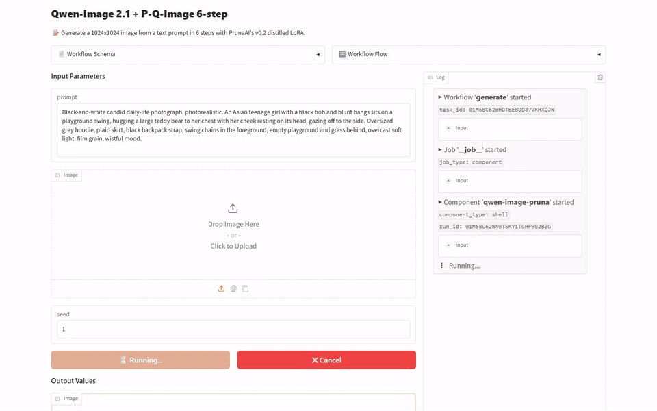
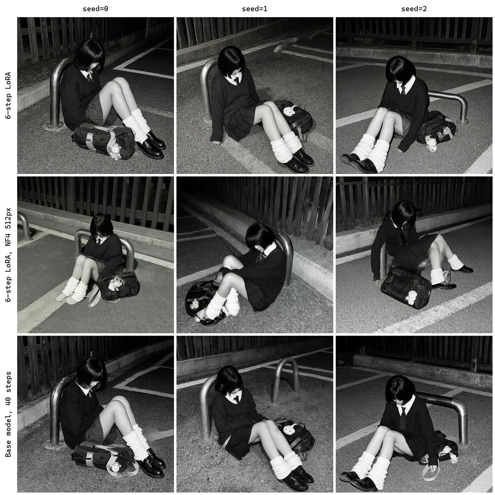
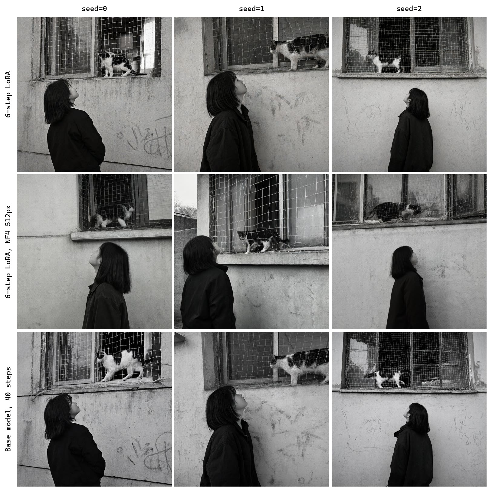
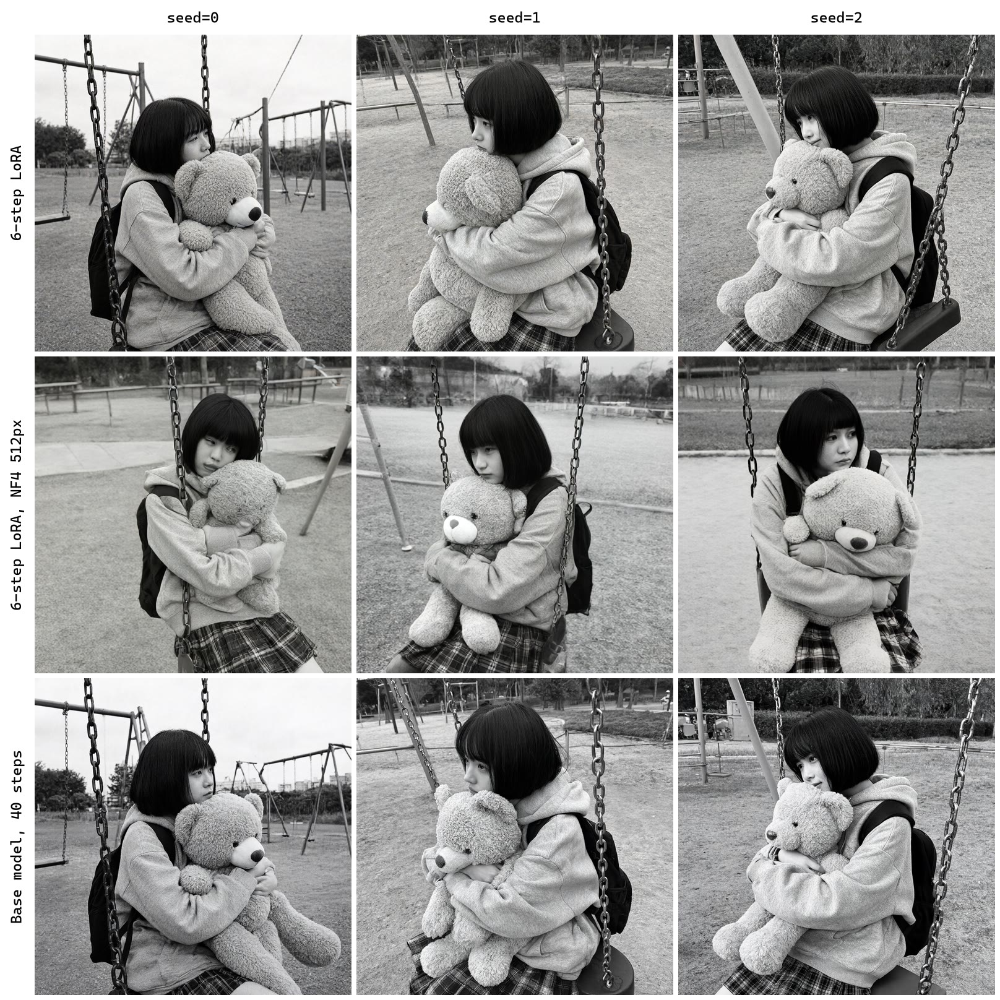

[English](README.md) · [한국어](README.ko.md) · [中文](README.zh.md)

# image-generation-qwen-image-pruna

This service takes text and makes an image with the P-Q-Image-2.1 6 steps v0.2 LoRA on top of Qwen/Qwen-Image-2.1.



## Quick Start

It needs [model-compose](https://github.com/hanyeol/model-compose) 0.4.121 or later.

Install with [uv](https://docs.astral.sh/uv/):

```bash
uv pip install model-compose
```

Or with pip:

```bash
pip install model-compose
```

Clone this repository:

```bash
git clone https://github.com/MindrLabs/image-generation-qwen-image-pruna
cd image-generation-qwen-image-pruna
```

Run it:

```bash
model-compose up
```

The API listens on http://localhost:8080/api and the Gradio UI opens at http://localhost:8081.

## Summary

On the DGX Spark, P-Q-Image-2.1 6 steps v0.2 took 10.9 seconds per image, faster than the 51.3 seconds of the Base model, 40 steps.

| Machine | Status | Settings | Seconds per image (seed=0) | Peak memory (MiB) (seed=0) |
| :---: | --- | --- | --- | --- |
| DGX Spark | Measured | P-Q-Image-2.1 6 steps v0.2 (6-step LoRA) | 10.9 | 39907 (VRAM) |
| RTX 4090 | Measured | P-Q-Image-2.1 6 steps v0.2 (6-step LoRA) | 46.4 | 17532 (VRAM) |
| MacBook M1 16GB | Measured | P-Q-Image-2.1 6 steps v0.2 (6-step LoRA, NF4 512px) | 115 | 15581 (footprint) |

## Setup

Measured with model-compose 0.4.121. Statistics use 95% intervals, and speed differences under 1.05× are not called.

| Settings | Inputs | Weights |
| :---: | --- | --- |
| P-Q-Image-2.1 6 steps v0.2 (6-step LoRA) | 3 inputs × 1 repeat | [Qwen/Qwen-Image-2.1](https://huggingface.co/Qwen/Qwen-Image-2.1/tree/d26bb61231c349cf6b7896fa83353113880e1ba3) + `p_q_image_2.1_6_steps_v0.2.safetensors` from [PrunaAI/P-Q-Image-2.1](https://huggingface.co/PrunaAI/P-Q-Image-2.1) |
| Base model, 40 steps | 3 inputs × 1 repeat | [Qwen/Qwen-Image-2.1](https://huggingface.co/Qwen/Qwen-Image-2.1/tree/d26bb61231c349cf6b7896fa83353113880e1ba3) |
| P-Q-Image-2.1 6 steps v0.2 (6-step LoRA, NF4 512px) | 3 inputs × 3 repeats | [Qwen/Qwen-Image-2.1](https://huggingface.co/Qwen/Qwen-Image-2.1/tree/d26bb61231c349cf6b7896fa83353113880e1ba3) + `p_q_image_2.1_6_steps_v0.2.safetensors` from [PrunaAI/P-Q-Image-2.1](https://huggingface.co/PrunaAI/P-Q-Image-2.1) |

## Results

### Text to Image

The composition and pose of three black-and-white daily-life scenes were written as English prompts and generated with three seeds.

| Claim | Check | Pass |
| :---: | --- | --- |
| A detailed prompt controls the subject, setting, lighting, and style of the image. | Judged by a person | ✓ |
| The 6-step adapter is meant as a drop-in replacement for the base model in generation workflows. | Judged by a person | ✓ |
| The v0.2 adapter lets Qwen-Image-2.1 generate a finished image in only 6 steps. | Judged by a person | ✓ |

We measured on MacBook M1 16GB, DGX Spark, RTX 4090. Each cell is the median over measured calls, leaving out any call made during other GPU work.

| Settings | Machine | Seconds per image (seed=0 / 1 / 2) | Peak memory (MiB) |
| :---: | --- | --- | --- |
| P-Q-Image-2.1 6 steps v0.2 (6-step LoRA, NF4 512px) | MacBook M1 16GB | 115 / 116 / 115 | 15581 (footprint) |
| P-Q-Image-2.1 6 steps v0.2 (6-step LoRA) | DGX Spark | 10.9 / 10.9 / 10.9 | 39907 (VRAM) |
| P-Q-Image-2.1 6 steps v0.2 (6-step LoRA) | RTX 4090 | 46.4 / 46.5 / 46.5 | 17562 (VRAM) |
| Base model, 40 steps | DGX Spark | 51.3 / 51.2 / 51.3 | 39515 (VRAM) |
| Base model, 40 steps | RTX 4090 | 62.7 / 62.7 / 62.6 | 17530 (VRAM) |



> Black-and-white candid daily-life photograph, photorealistic, at night under harsh flash. An Asian teenage girl in a school uniform — dark knit sweater, white collar, tie, pleated skirt, white slouch socks — sits slumped on the gravel ground, leaning back against a curved metal parking bollard, knees bent, head bowed so her black bob and bangs hide her face, utterly exhausted. Her school bag lies spilled open beside her with a small plush charm. Wooden fence and concrete curb behind, painted parking lines on the asphalt, flash-lit grainy snapshot, lonely late-night mood.



> Black-and-white candid daily-life photograph, photorealistic. An Asian teenage girl with a shoulder-length bob, seen from behind at a three-quarter angle in a dark jacket, standing below a ground-floor window and tilting her face up toward a black-and-white cat walking along the window ledge behind a white safety net. Rough plaster wall with faded graffiti, dusk light, soft film grain, quiet melancholic mood.



> Black-and-white candid daily-life photograph, photorealistic. An Asian teenage girl with a black bob and blunt bangs sits on a playground swing, hugging a large teddy bear to her chest with her cheek resting on its head, gazing off to the side. Oversized grey hoodie, plaid skirt, black backpack strap, swing chains in the foreground, empty playground and grass behind, overcast soft light, film grain, wistful mood.

## Recommendations

- Use P-Q-Image-2.1 6 steps v0.2 when speed matters. On the DGX Spark it took 10.9 seconds per image, faster than the 51.3 seconds of the Base model, 40 steps. A person who looked at the RTX 4090 outputs judged that image quality did not drop noticeably.
- On the MacBook M1 16GB, use the P-Q-Image-2.1 6 steps v0.2 (6-step LoRA, NF4 512px) setting. It took 115 seconds per image.

## Limitations and What We Did Not Measure

- The speed difference between P-Q-Image-2.1 6 steps v0.2 and the Base model, 40 steps comes from medians over 3 inputs, and no statistical verdict was made on it.
- Lighting was not judged in the prompt-control check.

### Measurement Conditions

| Item | Detail |
| :---: | --- |
| Constraint | The NF4 workflow ran on an Apple M1 with 16 GB of unified memory, where the whole pipeline stays in one memory pool. |
| Constraint | The NF4 workflow has no comparison against the base model without the add-on. |
| Constraint | On the RTX 4090 the BF16 workflows run with model CPU offload because the pipeline does not fit in 24 GB of VRAM, so each request also spends time moving modules between system memory and the GPU. |
| Constraint | On the DGX Spark the workflows run with CPU offload turned off, because its memory is shared between the CPU and the GPU. |
| Constraint | To repeat these runs, start the service with DEVICE=mps on the MacBook M1 16GB and with CPU_OFFLOAD=null on the DGX Spark. |

### Not Measured

| Subject | Item | Reason |
| :---: | --- | --- |
| DGX Spark vs RTX 4090 | Seconds per image (seed=0 / 1 / 2) | 3 inputs were measured on both machines without other GPU work, and at least 20 are needed to compare them. |

### Unchecked Model Card Claims

- Only the adapter's own step count and sigma schedule are supported, not other steps, schedules, or CFG values.
- Higher resolutions such as 2K are outside the training coverage and quality may vary.
- The adapter is not a standalone model and needs the Qwen-Image-2.1 base weights.
- Text-to-image and image editing run with the same pipeline and need a CUDA GPU.
- The 6-step adapter does not guarantee outputs identical to the base model.
- Text-to-image output starts at a height of 1024 pixels.
- Text-to-image output starts at a width of 1024 pixels.
- The adapters were trained at 1K resolution only, with editing of up to 3 reference images.
- The adapters make generation up to 6.3x faster than the base model.

## License

| Covers | License | Commercial use |
| :---: | --- | --- |
| This service | [`LICENSE`](LICENSE) | ✓ |
| Qwen/Qwen-Image-2.1 weights | [`MODEL_LICENSE`](https://huggingface.co/Qwen/Qwen-Image-2.1/blob/main/LICENSE) | ✗ |
| PrunaAI/P-Q-Image-2.1 LoRA | [`MODEL_LICENSE`](https://huggingface.co/PrunaAI/P-Q-Image-2.1/blob/main/LICENSE) | ✗ |
