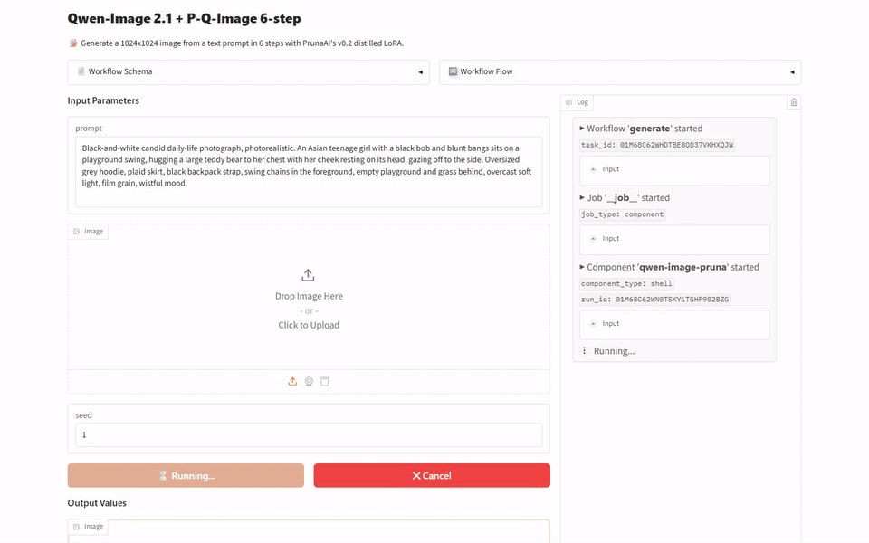
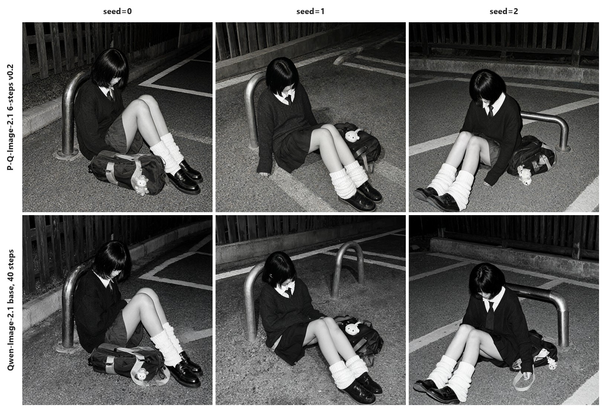
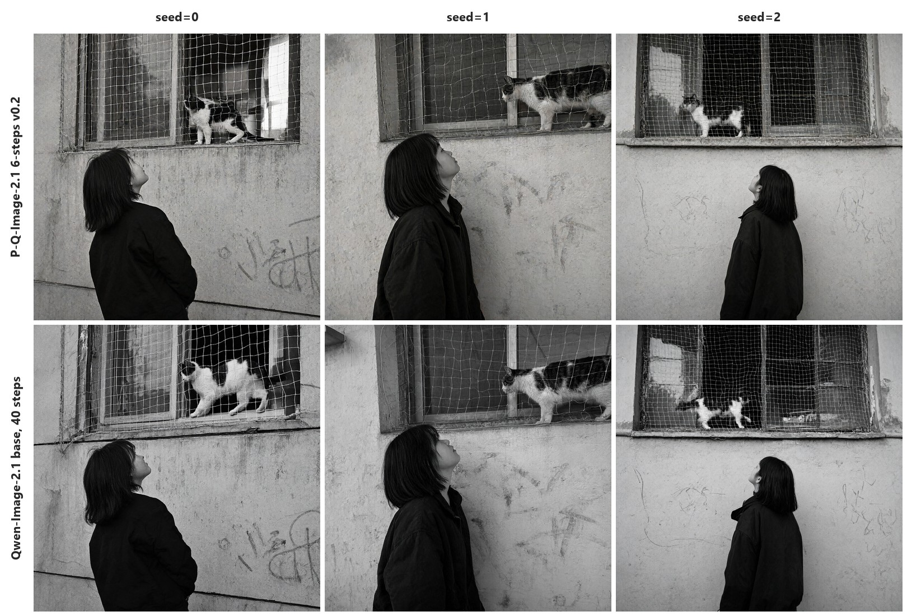
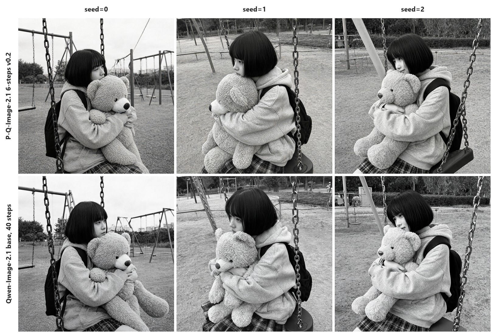

[English](README.md) · [한국어](README.ko.md) · [中文](README.zh.md)

# image-generation-qwen-image-pruna

这个服务接收文字，在 Qwen/Qwen-Image-2.1 上加 P-Q-Image-2.1 6-steps v0.2 LoRA 生成图像。

| 部分 | 权重 |
| :---: | --- |
| 基础模型 | [Qwen/Qwen-Image-2.1](https://huggingface.co/Qwen/Qwen-Image-2.1/tree/d26bb61231c349cf6b7896fa83353113880e1ba3) |
| LoRA | [PrunaAI/P-Q-Image-2.1](https://huggingface.co/PrunaAI/P-Q-Image-2.1) 的 `p_q_image_2.1_6_steps_v0.2.safetensors` |

## 演示



## 快速开始

需要 [model-compose](https://github.com/hanyeol/model-compose) 0.4.121 或更高版本。

使用 [uv](https://docs.astral.sh/uv/) 安装：

```bash
uv pip install model-compose
```

或使用 pip 安装：

```bash
pip install model-compose
```

克隆此仓库：

```bash
git clone https://github.com/MindrLabs/image-generation-qwen-image-pruna
cd image-generation-qwen-image-pruna
```

运行：

```bash
model-compose up
```

API 地址为 http://localhost:8080/api ，Gradio 界面地址为 http://localhost:8081 。

## 摘要

在 DGX Spark 上，P-Q-Image-2.1 6-steps v0.2 每张耗时 10.9 秒，比基础模型 40步 的 51.3 秒短，人工判定画质没有明显下降。

| 设备 | 状态 | 设置 | 每张秒数（seed=0） | 峰值内存（MiB，seed=0） |
| :---: | --- | --- | --- | --- |
| DGX Spark | 已测量 | P-Q-Image-2.1 6-steps v0.2 | 10.9 | 39907（VRAM） |
| RTX 4090 | 已测量 | P-Q-Image-2.1 6-steps v0.2 | 46.4 | 17532（VRAM） |
| MacBook M1 16GB | 已测量 | P-Q-Image-2.1 6-steps v0.2, NF4 512px | 115 | 15581（footprint） |
| RTX 4050 Laptop | 未测量 | — | — | — |

## 测量环境

| 设置 | 输入 | 检查点 | model-compose | 统计 |
| :---: | --- | --- | --- | --- |
| P-Q-Image-2.1 6-steps v0.2 | 3 个输入 × 1 次重复 | [Qwen/Qwen-Image-2.1](https://huggingface.co/Qwen/Qwen-Image-2.1/tree/d26bb61231c349cf6b7896fa83353113880e1ba3) | 0.4.121 | 95% 置信区间，低于 1.05× 的速度差异不作判定 |
| 基础模型 40步 | 3 个输入 × 1 次重复 | [Qwen/Qwen-Image-2.1](https://huggingface.co/Qwen/Qwen-Image-2.1/tree/d26bb61231c349cf6b7896fa83353113880e1ba3) | 0.4.121 | 95% 置信区间，低于 1.05× 的速度差异不作判定 |
| P-Q-Image-2.1 6-steps v0.2, NF4 512px | 3 个输入 × 3 次重复 | [Qwen/Qwen-Image-2.1](https://huggingface.co/Qwen/Qwen-Image-2.1/tree/d26bb61231c349cf6b7896fa83353113880e1ba3) | 0.4.121 | 95% 置信区间，低于 1.05× 的速度差异不作判定 |

## 结果

### 文生图

把三个以少女为主角的黑白日常场景的构图和姿势写成英文提示词，用三个种子生成。

| 声明 | 核对方式 | 通过 |
| :---: | --- | --- |
| 详细的提示词可以控制图像的主体、场景、光线和风格。 | 人工判定 | ✓ |
| 6步适配器用来在生成工作流中直接替代基础模型。 | 人工判定 | ✓ |
| v0.2 适配器让 Qwen-Image-2.1 只用 6 步就生成完整的图像。 | 人工判定 | ✓ |

在 DGX Spark、RTX 4090 和 MacBook M1 16GB 上测量；RTX 4050 Laptop 内存耗尽，没能测量。每格为所测调用的中位数，计算时不计入在其他 GPU 任务期间进行的调用。

| 设置 | 设备 | 每张秒数（seed=0 / 1 / 2） | 峰值内存（MiB） | 运行方式 |
| :---: | --- | --- | --- | --- |
| P-Q-Image-2.1 6-steps v0.2 | DGX Spark | 10.9 / 10.9 / 10.9 | 39907（VRAM） |  |
| P-Q-Image-2.1 6-steps v0.2 | RTX 4090 | 46.4 / 46.5 / 46.5 | 17562（VRAM） | 模型 CPU 卸载 |
| 基础模型 40步 | DGX Spark | 51.3 / 51.2 / 51.3 | 39515（VRAM） |  |
| 基础模型 40步 | RTX 4090 | 62.7 / 62.7 / 62.6 | 17530（VRAM） | 模型 CPU 卸载 |
| P-Q-Image-2.1 6-steps v0.2, NF4 512px | MacBook M1 16GB | 115 / 116 / 115 | 15581（footprint） | NF4 量化 |



> Black-and-white candid daily-life photograph, photorealistic, at night under harsh flash. An Asian teenage girl in a school uniform — dark knit sweater, white collar, tie, pleated skirt, white slouch socks — sits slumped on the gravel ground, leaning back against a curved metal parking bollard, knees bent, head bowed so her black bob and bangs hide her face, utterly exhausted. Her school bag lies spilled open beside her with a small plush charm. Wooden fence and concrete curb behind, painted parking lines on the asphalt, flash-lit grainy snapshot, lonely late-night mood.



> Black-and-white candid daily-life photograph, photorealistic. An Asian teenage girl with a shoulder-length bob, seen from behind at a three-quarter angle in a dark jacket, standing below a ground-floor window and tilting her face up toward a black-and-white cat walking along the window ledge behind a white safety net. Rough plaster wall with faded graffiti, dusk light, soft film grain, quiet melancholic mood.



> Black-and-white candid daily-life photograph, photorealistic. An Asian teenage girl with a black bob and blunt bangs sits on a playground swing, hugging a large teddy bear to her chest with her cheek resting on its head, gazing off to the side. Oversized grey hoodie, plaid skirt, black backpack strap, swing chains in the foreground, empty playground and grass behind, overcast soft light, film grain, wistful mood.

## 建议

- 需要快速生成时使用 P-Q-Image-2.1 6-steps v0.2。在 DGX Spark 上每张耗时 10.9 秒，比基础模型的 51.3 秒短。

## 局限与未测量的内容

### 测量条件

| 对象 | 内容 |
| :---: | --- |
| MacBook M1 16GB | NF4 工作流在 16 GB 统一内存的 Apple M1 上运行，整个流程都在同一块内存中。 |
| 显存独立的 GPU | NF4 流程先加载到 GPU，然后模型 CPU 卸载把空闲模块放在系统内存中，所以两者都要足够。 |
| NF4 加载 | 加载时会先读取 BF16 权重再量化，因此短时间内需要比量化后的流程更多的系统内存。所以一台 6 GB GPU、15 GB 系统内存的笔记本，即使总内存与 M1 相近，内存也会耗尽。 |
| NF4 比较 | NF4 工作流没有与去掉附加组件的基础模型比较。 |
| RTX 4090 | 24 GB 显存装不下整个流程，所以 BF16 工作流开启模型 CPU 卸载运行，每次请求还要花时间在系统内存和 GPU 之间搬运模块。 |
| DGX Spark | CPU 和 GPU 共用内存，所以关闭 CPU 卸载运行工作流。 |

### 未测量的内容

| 对象 | 原因 |
| :---: | --- |
| RTX 4050 Laptop | NF4 流程卸载到笔记本的 15 GB 系统内存时内存耗尽，在测量任何图像之前 Linux 环境就停止了。 |
| DGX Spark 与 RTX 4090 每张秒数（seed=0, 1, 2） | 两台机器在没有其他 GPU 任务时测量的输入有 3 个，比较至少需要 20 个。 |
| 提示词控制中的光线 | 提示词控制的判定没有看光线。 |
| 生成图像的宽和高 | 没有判定。 |

### 未验证的模型卡声明

- 适配器让生成速度比基础模型最快提高 6.3 倍。
- 只支持适配器自己的步数和 sigma 调度，不支持其他步数、调度或 CFG 值。
- 6步适配器不保证与基础模型输出相同。
- 2K 等更高分辨率超出训练范围，画质可能不同。
- 适配器只在 1K 分辨率上训练，编辑最多使用 3 张参考图像训练。
- 文生图的输出从 1024 像素的宽度和高度开始。
- 适配器不是独立模型，需要 Qwen-Image-2.1 基础权重。
- 文生图和图像编辑使用同一个流程，需要 CUDA GPU。这个服务的 NF4 工作流在 MacBook M1 16GB 上也能运行。

## 许可证

| 适用对象 | 许可证 | 商业使用 |
| :---: | --- | --- |
| 本服务 | [`LICENSE`](LICENSE) | ✓ |
| Qwen/Qwen-Image-2.1 权重 | [`MODEL_LICENSE`](https://huggingface.co/Qwen/Qwen-Image-2.1/blob/main/LICENSE) | ✗ |
| PrunaAI/P-Q-Image-2.1 LoRA | [`MODEL_LICENSE`](https://huggingface.co/PrunaAI/P-Q-Image-2.1/blob/main/LICENSE) | ✗ |
